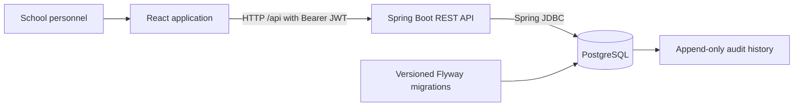

# ICI Local 2.0

Shared Supabase version: [teammate startup guide](docs/run-with-supabase.md). Accounts and demo records persist in the shared database; passwords/private configuration stay outside Git. The enrollment integration includes ICI2-13–19.

**Student records, enrollment management, and academic monitoring for Iligan Computer Institute.**

ICI Local 2.0 is a school Management Information System (MIS) being developed to bring applicant intake, credential verification, student records, and academic monitoring into one application. It covers **Iligan Main, Kapatagan, and Bugo, Cagayan de Oro**, with a focus on Senior High School and technical-vocational programs.

**Status:** Active development. The repository contains implemented backend services, an authenticated React application, and screens reserved for future workflows. It also preserves the high-fidelity prototype used to demonstrate the intended system.

[Getting started](#getting-started) / [Implementation status](#implementation-status) / [Architecture](#architecture) / [Testing](#testing) / [Documentation](#documentation)

## Project overview

The project replaces fragmented standalone records, spreadsheets, and paper workflows with shared institutional data and traceable staff actions.

| Module | Intended coverage |
| --- | --- |
| **Enrollment Management** | Applicant intake, duplicate review, credential checklists, attendance-based confirmation, and section allocation |
| **Academic Records** | Advisory rosters, teacher grade encoding, grading locks, corrections, incomplete grades, academic history, and withdrawal clearance |
| **Reporting & Monitoring** | Registrar summaries, document compliance, guidance interventions, academic achievement, official records, and cashiering reference exports |
| **Data Migration & Cutover** | Legacy student/grade imports, spreadsheet normalization, reconciliation, and migration sign-off |

Payment processing, general accounting, payroll, inventory/procurement, and learning-management features are outside the current project scope. Cashiering integration concerns reference data and clearance information.

The project uses **Scrumban**, with a planned team WIP limit of four and one active implementation task per developer. Work is tracked in Jira and the [ICI dependency board](https://eniloan4002.github.io/ici-dependency-board/).

## Implementation status

This table describes the current checked-out implementation. Refer to [implementation status](docs/implementation-status.md) and the corresponding commits/PRs when assessing a deployed or remote version.

| Area | Available implementation |
| --- | --- |
| **Database foundation: ICI2-5** | PostgreSQL schema, Flyway migrations, reference catalogs, relational constraints, audit metadata, and immutable change history |
| **Authentication: ICI2-6** | BCrypt password hashing, signed JWTs with role/campus claims, staff sign-in, session restoration, inactive-account checks, and durable logout revocation |
| **Staff account provisioning: ICI2-9 (partial)** | Admin-only creation, scoped directory, activation, role/campus editing, password changes and administrator-mediated recovery |
| **React foundation: ICI2-8** | Shared shell, role-aware navigation, protected routes, responsive sidebar, breadcrumbs, interface components, dialogs, and notifications |
| **Student master API: ICI2-12** | Student and guardian profiles, program/voucher classification, scoped search, validation, optimistic updates, and soft archiving |
| **Requirement tracking API: ICI2-15** | Application checklists, document status updates, completeness calculation, verification notes, version checks, and scoped audit history |
| **Integrated staff intake: ICI2-14** | Pauline’s queue/intake UI connected to persistent applications, real catalogs, guardians and explicit registrar review; duplicate adjudication and verified existing-student linking included |
| **Enrollment verification & sections: ICI2-16-19** | Credential checklist/history screens, attendance verification and gated confirmation, section configuration, and capacity-aware allocation |
| **Academic setup** | Working APIs and React forms for subjects, academic years, terms, and grading periods |
| **Prototype preservation** | Runnable high-fidelity reference and a separate 50-file snapshot with SHA-256 checksums |

**Work still required** includes full module/campus RBAC (ICI2-7), academic business services, reporting, and legacy migration tooling. Honor eligibility is deferred until ICI supplies approved rules.

A reserved React route or a working prototype interaction does not mean that its production workflow is complete. In particular, duplicate-detection changes made under `prototype/` are browser-demo behavior; the planned Spring Boot service is a separate implementation.

## Architecture



The frontend and backend are separate applications. During development, Vite proxies `/api` to the backend. Business data and token revocations persist in PostgreSQL; prototype data uses browser storage.

| Layer | Technologies used in this repository |
| --- | --- |
| Frontend | React 19, React Router 7, Axios, Vite 7, shared CSS and design tokens |
| Backend | Java 21 target, Spring Boot 3.5, Spring Security, Spring JDBC, Bean Validation, JJWT |
| Database | PostgreSQL 17 and versioned Flyway SQL migrations |
| Verification | JUnit/Spring Boot HTTP integration tests, native PostgreSQL test fixtures, Vitest, Testing Library, PGlite, and Playwright |
| Local infrastructure | Docker Compose with a persistent PostgreSQL volume; optional disposable native PostgreSQL launcher |

### Staff roles

The implementation plan defines seven staff roles. The responsibilities below describe the intended workflows; individual modules may still be under development.

| Role | Intended responsibility |
| --- | --- |
| System Administrator | Accounts, system configuration, and access administration |
| Registrar | Student records, enrollment validation, requirements, grade administration, and document issuance |
| Principal | Academic oversight, operational reporting, and withdrawal approvals |
| Teacher Adviser | Assigned advisory rosters, compliance monitoring, and withdrawal endorsement |
| Subject Teacher | Assigned subject grades and grade-correction requests |
| Guidance Staff | At-risk monitoring and counseling records |
| Cashiering Reference | Read-only enrolled-student, voucher, and clearance reference |

The requested Department Head preview uses the **Principal role**. It does not introduce an additional role. The prospective-student prototype entry is an application flow rather than one of these staff authentication roles.

Baseline API guards and campus checks are implemented for the available services. Full business permission mapping remains part of ICI2-7.

## Repository structure

```text
ISANDE1-Grp7/
├── ICILocal2.0/
│   ├── frontend/                 # Single React application
│   │   ├── src/                  # Authentication, routes, shell, setup UI
│   │   └── tests/                # Browser, archive, and schema checks
│   └── backend/                  # Spring Boot application and Maven wrapper
│       └── src/
│           ├── main/java/        # Auth, setup, student, requirement services
│           ├── main/resources/
│           │   └── db/migration/ # Versioned Flyway migrations
│           └── test/java/        # PostgreSQL-backed integration tests
├── prototype/                    # Working HTML/CSS/JS demonstration
├── archive/
│   └── high-fidelity-2026-11-02/  # Frozen original prototype and checksums
├── docs/                         # API contracts, schema, plans, verification
├── compose.yaml                  # Persistent local PostgreSQL service
└── .env.example                  # Configuration template; no real credentials
```

The React application retains the shell and route foundation contributed through PR #5, with the backend, authentication, and academic setup integrated into the same workspace.

## Getting started

For a step-by-step team walkthrough, including Windows PowerShell, see [Run the complete web app](docs/run-complete-app.md). For published versus local feature differences, see the [November 9 integration review](docs/team-integration-review-2026-11-09.md).

### Prerequisites

- **Java 21 or later**.
- **Node.js 22.12 or later**; Node 24 is recommended. Use the supplied lockfile with `npm ci`.
- **Docker with Compose v2** for the persistent local database, or use the disposable alternative below.
- Git. Python 3 is optional for serving the static prototype.

The backend includes the **Maven wrapper**, so a separate Maven installation is unnecessary. Initial dependency downloads require network access. Shell examples below use Bash/Zsh; on Windows use `mvnw.cmd` and the corresponding PowerShell environment-variable syntax.

### 1. Clone and configure

```sh
git clone https://github.com/Eniloan4002/ISANDE1-Grp7.git
cd ISANDE1-Grp7
cp .env.example .env
```

Edit `.env` before starting:

| Variable | Configuration |
| --- | --- |
| `DB_PASSWORD` | Choose a local PostgreSQL password |
| `DB_USER` | Defaults to `ici_local` |
| `DB_URL` | Defaults to `jdbc:postgresql://localhost:5432/ici_local` |
| `JWT_SECRET` | Base64-encoded random key containing at least 32 bytes |
| `JWT_TTL_MINUTES` | Defaults to `15`; supported range is `1 to 60` |

Generate a signing key locally and place the result in `JWT_SECRET`:

```sh
openssl rand -base64 32
```

The supplied Compose service creates the `ici_local` database and user. Changing `DB_USER`/`DB_URL` configures the backend connection; it does not rename the Compose database or user.

Docker Compose reads the root `.env` automatically. Spring Boot does not; export the values in the terminal that starts Java. If using the shell-loading commands below, keep `.env` valid shell syntax and quote values containing spaces or shell characters. The real `.env` is ignored by Git.

### 2. Provision the first administrator

For the first startup, also set these values in `.env`:

- `BOOTSTRAP_ADMIN_ENABLED=true`
- `BOOTSTRAP_ADMIN_USERNAME`: your chosen username
- `BOOTSTRAP_ADMIN_EMAIL`: your administrator email
- `BOOTSTRAP_ADMIN_PASSWORD`: at least 12 characters, at most 72 UTF-8 bytes

Bootstrap hashes the password and grants administrator access across active campuses. It does not reset an existing username. After successful provisioning, set `BOOTSTRAP_ADMIN_ENABLED=false`, clear the bootstrap password, and reload the environment before subsequent starts.

The shared Supabase database already contains the verified team/demo accounts; obtain their app passwords and the database password privately from the owner. A separate local/disposable database needs its own bootstrap and account setup. No shared passwords are published in this README.

### 3. Start PostgreSQL and the backend

From the repository root:

```sh
set -a
. ./.env
set +a

docker compose up -d database
cd ICILocal2.0/backend
./mvnw spring-boot:run
```

Wait for the database health check to become healthy (`docker compose ps` from the root) if the first backend connection fails during database startup.

Flyway initializes/upgrades the schema automatically. The backend listens at **[localhost:8081](http://localhost:8081)**. It serves REST APIs; there is no separate backend homepage.

### 4. Start the frontend

In a second terminal, from the repository root:

```sh
cd ICILocal2.0/frontend
npm ci
npm run dev
```

Open **[localhost:5173/sign-in](http://localhost:5173/sign-in)** and sign in with the administrator you provisioned. Academic configuration is available at `/setup`.

Vite forwards `/api` to `http://127.0.0.1:8081`. To use another backend address:

```sh
ICI_API_URL=http://127.0.0.1:18081 npm run dev
```

### Disposable database alternative

For development without Docker, the test-classpath launcher starts a **temporary native PostgreSQL 17 database** and the backend. From the repository root, load your chosen bootstrap environment as above, then run:

```sh
cd ICILocal2.0/backend
./run-local-postgres.sh
```

This launcher uses test infrastructure and a test signing key. Its database is discarded on shutdown; accounts and records created there are temporary. The test launcher is excluded from the packaged production application.

The Docker service uses a named volume and retains its records across restarts. Stop it from the root with:

```sh
docker compose stop database
```

## API overview

Business endpoints require `Authorization: Bearer <accessToken>`. Detailed request fields, validation rules, response shapes, and permission boundaries are in the linked contracts.

| Area | Main endpoints | Contract |
| --- | --- | --- |
| Authentication | `POST /api/auth/login`, `GET /api/auth/me`, `POST /api/auth/logout` | [Authentication](docs/authentication.md) |
| Academic setup | `/api/setup/subjects` and calendar resources under `/api/setup` | [Setup API](docs/setup-api.md) |
| Students | `GET/POST /api/students`, `GET/PUT/DELETE /api/students/{id}`, `GET /api/students/reference-data` | [Student master API](docs/student-master-api.md) |
| Requirements | `GET /api/requirement-types`, `GET /api/applications/{id}/requirements`, `PUT /api/applications/{id}/requirements/{code}` | [Requirement tracking](docs/requirement-tracking-api.md) |
| Requirement history | `GET /api/applications/{id}/requirements/audit` | [Audit contract](docs/requirement-tracking-api.md) |

Student deletion is **soft archiving**. Requirement completeness concerns credentials only; it does not confirm attendance or enrollment. Requirement endpoints use the numeric **application ID**, not the student ID or display application number.

## Testing

### Backend and real PostgreSQL

From the backend directory:

```sh
./mvnw verify
```

The suite starts native PostgreSQL 17 and tests migrations, upgrades, HTTP authentication, token revocation, scoped student APIs, requirement verification, immutable audits, stale updates, and concurrent writes. No Docker daemon or pre-existing database is needed. Tests run as a normal OS user rather than root.

Test binary dependencies cover Windows/Linux x86-64 and macOS Intel/Apple Silicon. Other architectures require the matching embedded PostgreSQL binary dependency.

### Frontend, schema, and archive

From the frontend directory:

```sh
npm test
npm run build
```

`npm test` runs the React unit tests followed by schema/archive checks. The latter use PGlite and verify the frozen prototype's checksums independently of the working prototype.

### Browser workflows

Install Chromium once:

```sh
npx playwright install chromium
```

Start a backend with a dedicated test administrator. Stop any manually started frontend on port 5173: Playwright starts its own Vite server there. Then run from the frontend directory:

```sh
export ICI_TEST_USERNAME=your-test-admin
export ICI_TEST_PASSWORD='replace-with-the-test-account-password'
ICI_LIVE_API=1 npx playwright test
```

Replace the example test values with your dedicated account credentials. Set `ICI_API_URL` when the backend uses another port. Without `ICI_LIVE_API=1`, the current authenticated browser workflows explicitly skip; a successful skipped run is not end-to-end verification.

Browser tests create sample setup records. Use a disposable/dedicated test database. Read the [verification record](docs/verification.md) for executed checks and their limits.

## High-fidelity prototype

The static prototype demonstrates the broader enrollment, academic, and guidance journeys before their production APIs/screens are complete. It uses seeded browser storage and demo role selection.

From the repository root:

```sh
python3 -m http.server 8080
```

- [Working prototype](http://localhost:8080/prototype/)
- [Frozen high-fidelity snapshot](http://localhost:8080/archive/high-fidelity-2026-11-02/)
- [Cross-module demonstration scenario](prototype/DEMO_SCENARIO.md)
- [Archive provenance and limitations](archive/high-fidelity-2026-11-02/ARCHIVE.md)

The archive's `MANIFEST.json` records SHA-256 hashes for the 50 captured source files. Continue development in the application workspace and keep the frozen snapshot intact.

## Database changes and collaboration

- Add new versioned SQL files under `ICILocal2.0/backend/src/main/resources/db/migration/`.
- Coordinate the next unused Flyway version with other developers. Do not rewrite a migration already applied to a shared database.
- Let Flyway manage application schema changes; do not manually apply its SQL files or use automatic Hibernate schema updates.
- Use restricted runtime credentials and a separate schema owner when preparing a deployment; the Compose owner account is intended for local development.
- Work on a task branch, reference its Jira key, and open a PR with the behavior changed and relevant validation.
- Review existing PRs and API contracts before adding overlapping routes, roles, or services.
- Check both authentication and campus scope when integrating new endpoints. Browser navigation is not server authorization.

For deployed hosting, route `/api` to Spring Boot on the same origin and serve the frontend's `index.html` for client-side routes. Deployment configuration is separate from the local Vite proxy.

## Documentation

| Document | Contents |
| --- | --- |
| [Implementation plan](docs/reference/implementation-plan.md) | Project scope, epics, features, work breakdown, and milestones |
| [Implementation status](docs/implementation-status.md) | Delivered areas and remaining task boundaries |
| [Database schema](docs/database-schema.md) | Entity groups, invariants, assumptions, and migrations |
| [Core relational map](docs/database-erd.md) | Main entity relationships |
| [Authentication](docs/authentication.md) | Token lifecycle, bootstrap, configuration, and security boundaries |
| [Staff login fix](docs/staff-login-fix.md) | Real role accounts, provisioning, redirects and team handoff |
| [Academic setup](docs/setup-api.md) | Subject/calendar management API |
| [Student master](docs/student-master-api.md) | Profile, guardian, search, validation, and archive API |
| [Requirement tracking](docs/requirement-tracking-api.md) | Checklist states, completeness, versioning, and audit API |
| [Pauline frontend integration](docs/pauline-enrollment-integration.md) | Intake/requirements integration, API additions, collaborator handoff and GC update |
| [Enrollment workflows](docs/enrollment-workflows.md) | Verification screens, confirmation gates, section configuration and allocation |
| [PR #5 integration review](docs/pr-5-integration-review.md) | Workspace consolidation, compatibility fixes, and verification |
| [Verification](docs/verification.md) | Test evidence and environment limits |

## Project team

- Anton Adriano
- Elijah Lobitaña
- Pauline Novera
- Linus Tabanao

Developed as the **ISANDE1 Group 7** academic project for Iligan Computer Institute's proposed ICI Local 2.0 system.

Current enrollment integration: see the [November 10 reconciled QA](docs/qa/2026-11-10-reconciled/review-report.md), [migration guide](docs/migration-reconciliation.md), and [ICI2-13–19 demo/manual checklist](docs/demo-13-19-checklist.md). Published migrations V1–V7 are preserved; local additions are V8–V11. See the shared Supabase guide for the published setup.
