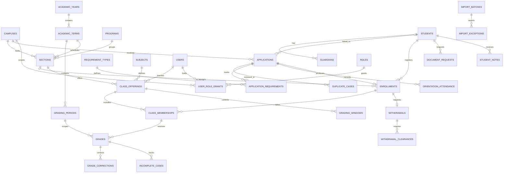

# Core relational map

This diagram shows the core relationships. See database-schema.md and the SQL migrations for the full table inventory and constraints.

Reporting queries derive from relational records rather than maintaining duplicate summary tables. Honor policy tables are intentionally deferred until institutional rules are provided.
